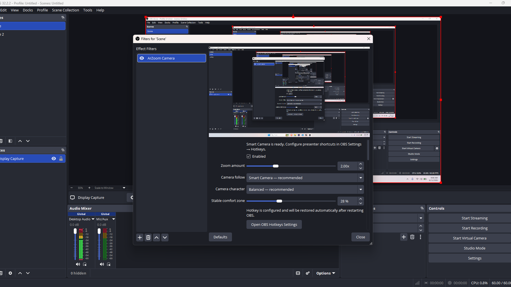

# ArZoom for OBS

<p align="center">
  
</p>

<p align="center">
  <strong>Smart Camera, Premium Click Feedback, Shortcut Keycaps & Spotlight for OBS.</strong><br>
  Zoom where you are explaining, stay steady while you teach, and guide attention without rewriting the OBS scene.
</p>

<p align="center">
  <a href="https://github.com/masarray/arzoom-follow-obs/releases/latest/download/ArZoom-OBS-Setup-windows-x64.exe"></a>
  <a href="https://masarray.github.io/arzoom-follow-obs/"></a>
</p>

<p align="center">
  
  
  
  <a href="LICENSE"></a>
</p>

ArZoom is a native OBS presentation-camera plugin for tutorials, engineering training, software demonstrations, online classes, product walkthroughs, and live streaming.

**[Download the latest Windows stable release](https://github.com/masarray/arzoom-follow-obs/releases/latest).** It retains the native P4.1 camera, P5 cinematic Spotlight, click feedback, opt-in shortcut keycaps and compact OBS Properties. This update adds **13 Presentation Cursor presets**, including Blue Sleeve Hand, plus **Spotlight Focus Area to 400%** and **Cursor Size to 160 px**. Mouse clicks **never** activate auto zoom.

**Latest stable downloads (automatic, version-independent):** [Windows installer](https://github.com/masarray/arzoom-follow-obs/releases/latest/download/ArZoom-OBS-Setup-windows-x64.exe) · [Portable/manual ZIP](https://github.com/masarray/arzoom-follow-obs/releases/latest/download/ArZoom-OBS-Manual-windows-x64.zip) · [SHA-256 checksums](https://github.com/masarray/arzoom-follow-obs/releases/latest/download/SHA256SUMS.txt) · [Release notes](https://github.com/masarray/arzoom-follow-obs/releases/latest). These direct file links always select GitHub's **latest non-prerelease** without requiring visitors to browse the GitHub Releases page.

**Privacy:** shortcut keycaps are OFF by default. When switched on, the Windows keyboard observer displays recognized action chords, not ordinary typing; it does not store typed text or clipboard history. Disable the optional feature during sensitive work.


<p align="center">
  
</p>

## Highlights in v0.7.3

### Expanded Spotlight and hand-pointer options

- **Spotlight Focus Area: 50–400%** (5% steps, unchanged 170% default); at 400%, the lit area can fill most of the screen.
- **Pointer Size: 24–160 px** (default 52 px), enlarged with camera zoom and capped at **512 output pixels**. Extremely large cursors may look softer due to 160×160 source artwork.
- **13 built-in cursor styles**, including Blue Sleeve Hand with a full cylindrical cuff, Cartoon Hand Pointer, 3D Hand Pointer, Premium Chrome Arrow and Premium Hand Chrome. **Premium Hand Chrome** is the new-filter default; saved selections remain intact.


### Premium click, shortcut keycaps, and compact controls

- One luminous expanding ring highlights left, right, and middle clicks; rapid clicks on the same target recharge a single pulse rather than stacking circles.
- Optional raised physical shortcut keycaps appear bottom-center when recognized action shortcuts are pressed. Normal typing, Shift-only printable characters, and AltGr text remain hidden. **Default OFF.**
- Simplified native OBS Properties: concise labels and contextual help, one hotkey entry point, Spotlight controls that expand when enabled, and advanced settings available when requested.
- The click and shortcut presentation layers do not alter the scene-camera authority or automatic zoom intent.

### Cinematic Spotlight with Zoom

When Spotlight controls are enabled, Toggle Zoom can automatically guide attention with a restrained cinematic iris:

```text
full scene
   ↓ Toggle Zoom ON
full-frame aperture → smooth Circle focus
background dim follows gently
   ↓
focused presentation
   ↓ Toggle Zoom OFF
Circle opens → full bright context
```

The animation is time-based, minimum-jerk, reversible mid-transition, and does not create a second camera authority.

Accepted default Spotlight presentation settings:

- mode: **Follow cursor**;
- shape: **Circle**;
- area size: **170%**;
- background dim: **35%**;
- edge softness: **40 px**;
- Presentation Cursor: **Premium Hand Chrome**;
- Cinematic Spotlight with Zoom: **On** after Spotlight controls are enabled;
- cinematic speed: **Balanced**.

The master **Enable Spotlight controls** setting remains Off by default, so adding ArZoom never places a Spotlight on-air without presenter opt-in.

### Zoom +/- is resize-only

Toggle Zoom ON/OFF owns the cinematic open/close choreography. While Zoom is already active, **Zoom In / Zoom Out only resize the camera, Presentation Cursor, and Spotlight smoothly**; they do not replay the cinematic focus animation.

### D3D11-safe shared shader ABI

An earlier P5 regression caused black output when shader parameters were not initialized. The stable renderer now primes shared Draw parameters deterministically and preserves a safe fallback when the optional keycap shader ABI is unavailable. A full renderer/backend matrix is not claimed for v0.7.3.

## Scene Camera architecture

```text
OBS Scene
├─ Display Capture
├─ Webcam
├─ Browser
├─ Logo
└─ Nested Scene
       ↓ OBS native composition
scene obs_source_t
       ↓ normal OBS effect-filter chain
ArZoom Camera
       ↓
SceneViewportPlanner (WHERE)
       ↓
SceneKinematicMotion (HOW)
       ↓
Presenter Controls / click / cursor / Spotlight
       ↓
final scene output
```

ArZoom intentionally does **not** implement scene-wide zoom by persistently rewriting scene-item position, scale, rotation, bounds, or crop.

Architecture invariants:

- no persistent scene-item transform mutation;
- no custom scene-wide Camera input source;
- no duplicate scene-render graph;
- no CPU frame readback;
- no helper source for Spotlight;
- no second semantic Smart Camera/planner;
- bounded O(1) presentation state;
- OBS pass-through remains available when presentation effects are inactive.

## Install

### Recommended: Windows installer

**[Download latest ArZoom Windows installer EXE](https://github.com/masarray/arzoom-follow-obs/releases/latest/download/ArZoom-OBS-Setup-windows-x64.exe)** · **[Download latest portable/manual ZIP](https://github.com/masarray/arzoom-follow-obs/releases/latest/download/ArZoom-OBS-Manual-windows-x64.zip)**

Close OBS completely before installation. The installer supports Standard OBS Studio and OBS Portable/custom roots containing `bin\64bit\obs64.exe`.

The [manual ZIP](https://github.com/masarray/arzoom-follow-obs/releases/latest/download/ArZoom-OBS-Manual-windows-x64.zip) and [SHA-256 checksums](https://github.com/masarray/arzoom-follow-obs/releases/latest/download/SHA256SUMS.txt) are published alongside this installer. Download the [latest stable release notes](https://github.com/masarray/arzoom-follow-obs/releases/latest) for upgrade details. Both EXE and ZIP links above are permanent latest-stable redirects; pre-releases are excluded.

## Recommended workflow

1. Put one visible top-level **Display Capture** in the presentation scene.
2. In OBS choose **Tools → ArZoom — Toggle Scene Camera**.
3. Choose **Tools → ArZoom — Configure Scene Camera**.
4. Disable old per-source ArZoom filters while Scene Camera is active to avoid double zoom.
5. If using ArZoom Presentation Cursor, disable the native Display Capture cursor to avoid a double cursor.
6. Assign presenter controls in **OBS Settings → Hotkeys**.
7. In native filter Properties, turn **Enable spotlight** on only when required. Use **Animate with zoom** for the optional cinematic transition; Spotlight is Off by default.
8. Leave **Show shortcut keys** Off unless your tutorial needs visible action shortcuts; turn **Show advanced options** on for monitor/precision settings.

The existing per-source **ArZoom Filter** remains available for the lightest Display Capture-only workflow.

## Mapping safety

Scene-wide pointer-driven Smart Follow, click anchoring, Presentation Cursor, and Cursor Spotlight use the same read-only Display Capture → scene mapping.

Supported stable scope:

- exactly one visible top-level Display Capture as presentation owner;
- deterministically resolved captured monitor;
- positive axis-aligned fullscreen, scaled, or inset placement;
- crop-aware mapping when proven;
- shared mapping for Smart Follow, click, cursor, and Spotlight focus.

ArZoom fails safe instead of guessing when ownership or geometry is ambiguous. Deterministic multi-capture ownership remains future P4.2 work.

## Presenter Controls

Profile-persistent OBS hotkeys include:

- Toggle Zoom;
- Hold Zoom;
- Freeze Camera;
- Toggle Smart Follow;
- Zoom In / Zoom Out;
- Reset / Full Frame;
- Overview Peek;
- Toggle Spotlight;
- Hold Spotlight.

## Presentation Cursor and click feedback

**13 built-in cursor presets** are available, including Blue Sleeve Hand, Cartoon Hand Pointer, 3D Hand Pointer, Premium Hand Chrome and legacy procedural pointers. Cursor size is **24–160 px** and follows live camera zoom up to a **512 px** output cap, with its hotspot kept aligned.

Click feedback is GPU-native, content-anchored and bounded. Left/right/middle clicks create a single luminous ring; quick repeated clicks at the same point recharge it. Click feedback never starts automatic Zoom.

Optional **Shortcut keys** render physical-style keycaps bottom-center for recognized action chords, with no normal-typing history. The Windows observer is opt-in and disabled when the feature is not in use; see the [privacy policy](docs/privacy.html).

## Performance principles

ArZoom does not require AI, OCR, image recognition, cloud processing, or frame analysis. The hot path is built around deterministic math, one shared presentation pass, bounded state, no growing histories, no per-frame file/settings writes, and no frame readback.

## Compatibility

| Item | v0.7.3 support |
|---|---|
| Operating system | Windows 10/11 x64 |
| Build baseline | OBS Studio 31.1.1 |
| v0.7.2 user-supplied functional recording (prior baseline) | OBS 33.0.1 · 1920×1080/60 FPS (short smoke test) |
| Earlier P5 verification | OBS 32.1.2 / D3D11 (previous baseline, not full v0.7.3 matrix) |
| Scene Camera | Supported |
| Per-source Display Capture filter | Supported |
| Scene-wide Smart Follow | One proven top-level Display Capture; deterministic axis-aligned fullscreen/scale/inset/crop mapping |
| Spotlight | Smart Focus / Follow cursor / Click to lock |
| Cinematic Spotlight with Zoom | Supported |
| Zoom range | 1.10×–4.00× |
| Multi-monitor | Supported, including negative desktop coordinates |
| Standard OBS installer | Supported |
| OBS Portable/custom root | Supported |
| Multiple Display Capture ownership | Future P4.2; never guessed |
| macOS / Linux | Not included in current release |

## Engineering gates

The v0.7.3 candidate passed [Windows CI run #43645833252](https://github.com/masarray/arzoom-follow-obs/actions/runs/43645833252), including deterministic regression tests, PNG validation, release-policy tests, plugin compilation and EXE/ZIP packaging. The earlier v0.7.2 1080p60 OBS recording demonstrates the retained click/keycap baseline, **not** the new hand cursors or extended settings. Direct new-feature OBS capture, 4K performance measurements, soak and clean-install matrices remain unverified; see [`docs/RELEASE_ACCEPTANCE_v0.7.3.md`](docs/RELEASE_ACCEPTANCE_v0.7.3.md).

Run locally on Windows PowerShell:

```powershell
./scripts/run-phase0-validation.ps1
```

## Build from source

Requirements: Windows 10/11 x64, Git, CMake 3.28+, Visual Studio 2022+ with Desktop development with C++, and Inno Setup 6 for EXE packaging.

```text
build-local-windows.bat
```

## Contributor / AI development direction

Read in this order:

1. **[Current Project Direction](docs/PROJECT_DIRECTION.md)**
2. **[P4.1 Stable Baseline](docs/P4_1_STABLE_BASELINE.md)**
3. **[P5 Stable Baseline](docs/P5_STABLE_BASELINE.md)**
4. historical phase/design documents only for context.

Do not revive the superseded custom scene-camera source/off-screen-render experiment, persistent scene-item mutation, or a competing semantic camera planner. Do not weaken accepted motion, shader-ABI, or presentation-safety gates merely to make new work pass.

## Privacy

ArZoom does not send analytics, cursor data, captured video, click data, or presentation content anywhere.

## License

ArZoom is open-source software licensed under [GPL-2.0-or-later](LICENSE).

OBS Studio is a trademark of its respective owners. ArZoom is an independent community project and is not affiliated with or endorsed by the OBS Project.
